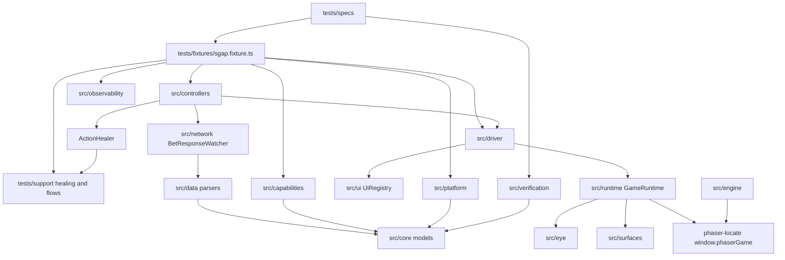

# 01 — Repository architecture

> Audit date: 2026-11-11. Read-only. Finding ids: `10_EVIDENCE_INDEX.md`.

## Repository map

SGAP is a single Node package (`package.json` name `sgap`). There is no monorepo and no `pages/` Page Object layer. The approved structure document explicitly rejects POM (`docs/architecture/layers/REPOSITORY_STRUCTURE.md`).

```text
SlotGameAutomation/
  package.json, playwright.config.ts, tsconfig*.json
  config/          manifests, packages, surfaces, symbols, environments,
                   qa-suites.json, parallel-workers*.json, generated/, reporting/
  docs/            architecture (working map), catalogs (QA case lists),
                   handbook (early plan + outline constitutions), guides, tests, perf
  src/             framework (see module table)
  tests/           fixtures, specs, support
  scripts/         runners, monitor server, Allure publish, QA page
  allure-history/  immutable published runs (326 folders observed 2026-11-11)
  allure-report/   shortcut copy of the latest publish
  test-results/    runtime output (not a source of architecture)
```

`docs/packages/` holds printed package PDFs. This audit did not extract PDF text.

## `src/` versus the folder map

`REPOSITORY_STRUCTURE.md` (status “Approved”) lists folders that exist and assigns them responsibilities. Several of those folders are **markers**. Several real modules are **absent from that map** and described instead in `docs/architecture/README.md`.

| Path | Folder-map claim | What the code is (2026-11-11) |
|---|---|---|
| `src/core/` | Contracts, models, constants. No Playwright. | Matches. `src/core` does not import Playwright. |
| `src/platform/` | Host bootstrap | `PlaywrightPlatform`, `UrlPlatform`, manifest/env loaders, canvas primer, portrait guard |
| `src/driver/` | iframe / canvas driver | `PlaywrightGameDriver` plus calibrate/probe CLIs, several still defaulting to `sugar-wonderland` |
| `src/controllers/` | Action API | 10 controller classes + registry + `ActionHealer` strategy |
| `src/ui/` | Locator registry | `UiRegistry` resolves keys from the manifest |
| `src/network/` | Capture | `BetResponseWatcher`, `RoundTracker`, scratch hub client/watcher, `PLATFORM_ROUTES` |
| `src/data/` | Bet, balance, history, session, wallet | Parsers only: `parse-bet-response.ts`, `parse-balance.ts` |
| `src/verification/` | Outcome checks | Functions, not an `IVerificationLibrary` class |
| `src/reporting/` | Tracker, JSON, Sheets append, evidence | Implemented. Sheets append is env-gated |
| `src/shared/` | Pure helpers | `json-path`, run paths, bet levels, spin-payload discovery |
| `src/events/` | Event observers | `EVENTS_LAYER` and `EVENT_REGISTRY` constants only |
| `src/state/` | State machine and locks | `STATE_LAYER` only. `GAME_STATES` comment says the machine is not implemented |
| `src/readiness/` | Init guards | `READINESS_LAYER` only. Readiness is `ActionHealer` + `RoundTracker` + canvas helpers |
| `src/traceability/` | Manual ↔ automation | `TRACEABILITY_LAYER` only. Mapping is `tests/support/test-catalog.ts` |
| `src/ai/` | Reserved, not a runtime dependency | `README.md` only. Matches the reservation |
| `src/eye/` | **Not in the folder map** | HUD/blocker vision, intent gate, learned ratios |
| `src/runtime/` | **Not in the folder map** | `GameRuntime` locate/click, `phaser-locate.ts`, iframe inventory |
| `src/engine/` | Described in architecture README, not the folder map | `engineIdFor` / `engineFor`. Adapters: phaser, opaque canvas, dom |
| `src/capabilities/` | Described in architecture README | `capabilityStatus`, package profiles, eligibility |
| `src/observability/` | Described in architecture README | Monitor Worker recorder, sink, redaction |
| `src/discovery/` | **Not in the folder map** | Runtime learning for a pasted Game URL |
| `src/perf/` | **Not in the folder map** | FPS sampler, asset audit, baselines |
| `src/surfaces/` | **Not in the folder map** | Loads `config/surfaces/` |
| `src/tools/` | **Not in the folder map** | Click recorder CLI |

Public barrel `src/index.ts` (`SGAP_VERSION = '0.1.0'`) re-exports core, platform, driver, **SpinController only** (other controllers export from `src/controllers/index.ts`), parsers, verification functions, network watcher, reporting tracker, UI registry, and eye/runtime helpers. It does **not** export engine, capabilities, observability, discovery, or perf.

## Module responsibilities

### Platform

`PlaywrightPlatform` (`src/platform/playwright-platform.ts`): `openGameHost`, `openGame`, desktop/mobile/landscape view prep, portrait relock, reload, initialize balance/body, `dispose`.

`UrlPlatform` (`src/platform/url-platform.ts`): pasted Game URL host. Selected by the fixture when `SGAP_LAUNCH_URL_REF` is set.

`FileGameManifestLoader` is the only manifest loader (`src/platform/manifest/file-game-manifest-loader.ts`). Controllers receive a `GameManifest` object. They do not read `config/manifests` themselves.

`canvas-session-primer.ts`: `primeCanvasSession`, overlay clear, settle to base game, leftover feature-spin drain. One leftover tap ratio remains in this file (`{ x: 0.5, y: 0.55 }`, labeled `fs-advance`).

### Driver

`PlaywrightGameDriver.attach` resolves the iframe through `UiRegistry.resolveIframe` → `manifest.iframeSelectorKey`. Production manifests use `iframe[title="Game session"]`.

`IGameDriver` requires `attach`, `isAttached`, `click`, `clickCanvas`, `readText`, `detach`. The class also exposes `clickCanvasAt`, `canvasPagePoint`, `captureCanvasForVision`, `getPage`, `getFrame`, `gameCanvas`.

### Controllers

Each class implements `isAvailable()` and `getLockState()`. Registry: `ControllerRegistry` in `src/controllers/registry/controller-registry.ts`.

| Class | File | Notable methods |
|---|---|---|
| `SpinController` | `src/controllers/spin-controller.ts` | `spinAndRead` (not on `ISpinController`), `spin`, `clickSpin` |
| `AutoplayController` | `autoplay-controller.ts` | `start`, `stop`, `isAutoplayActive` |
| `BuyFeatureController` | `buy-feature-controller.ts` | `buy`, `openPanel` |
| `BetController` | `bet-controller.ts` | `increase`, `decrease`, `setBet`, `observeBet` |
| `AmplifyBetController` | `amplify-bet-controller.ts` | `enable`, `disable`, `rearm` |
| `TurboController` | `turbo-controller.ts` | `enable`, `disable`. Local boolean. Comment: Package 1 `/bet` has no turbo field |
| `MenuController` | `menu-controller.ts` | `open`, `close`. Close points come from `surface.controls.menuClose.candidates` |
| `SettingsController` | `settings-controller.ts` | `open`, `close` |
| `FullscreenController` | `fullscreen-controller.ts` | `enter`, `exit` |
| `ScratchCardController` | `scratch-card-controller.ts` | Hub connect, size, buy, scratch, drawer reads. Contract interface only types `open`/`close` |

`HealableAction` is only `'spin'`. Buy and autoplay retries do not go through `ActionHealer.recover`. `docs/architecture/NEXT_STEPS.md` lists that as future step C.

Canvas healing is constructed in test support (`tests/support/canvas-action-healer.ts`) and attached by the fixture when `metadata.rendering` is canvas. DOM games get `NO_HEAL`.

### Engine

`engineIdFor` (`src/engine/engine-adapter.ts`): `metadata.engine` if set, else `phaser` when `metadata.rendering === 'canvas'`, else `dom`. **No production manifest sets `metadata.engine`.** Canvas titles therefore resolve to Phaser. `engineFor` throws if that id was not registered.

Architecture README says call sites still import `src/runtime/phaser-locate.ts` directly and that migrating them is unfinished (`NEXT_STEPS` step E). `phaser-locate.ts` looks up `window.phaserGame`. Bands come from the surface profile (`bandFor`), not a hardcoded Sugar box in that file.

### Capabilities

`capabilityStatus` order (`src/capabilities/game-capabilities.ts` lines 66–82):

1. Controller id: missing entry → `unmapped`; `enabled` true/false → `supported` / `unsupported`.
2. Feature: `metadata[cap] === "false"` → `unsupported` immediately.
3. Config-backed (`reelValidation`, `symbolCatalog`): data present → `supported`, else `unmapped`. A package boolean cannot claim these.
4. `metadata[cap] === "true"` → `supported`.
5. Package `capabilities[cap]` true/false.
6. Else `unmapped`.

`FEATURE_CAPABILITIES`: `normalModeMultiplier`, `freeSpins`, `scatterTrigger`, `freeSpinRetrigger`, `tumble`, `multiplierWild`, `scatterMode`, `reelValidation`, `symbolCatalog`, `maxWin`.

Controller ids (`CONTROLLER_IDS`): `spin`, `autoplay`, `buyFeature`, `bet`, `amplifyBet`, `turbo`, `menu`, `settings`, `fullscreen`, `scratchCard`.

### Verification, data, network

See `03_NETWORK_AND_GAMEPLAY_DATA.md` and `06_GAMEPLAY_TRACKERS_AUDIT.md`. Short form: verification is free functions. Only `BetResponseWatcher` implements a data-source interface (`IBetResponseDataSource`). History, session, and wallet source interfaces have no class.

## Entry points

| Entry | What it starts |
|---|---|
| `playwright.config.ts` | Projects, timeouts, reporters. Rewrites `projects` when `SGAP_PARALLEL_WORKERS=1` |
| `scripts/run-parallel-workers.mjs` | Lane processes + worker monitor + Allure publish |
| `scripts/run-suite-queue.mjs` | One parallel run per package from `config/qa-suites.json` |
| `scripts/qa-testing-page.mjs` | Local QA panel, default port 3850 |
| `scripts/run-staging-tests.mjs`, `run-regression-staging.mjs`, `run-package-games-staging.mjs` | Sequential or multi-project staging drivers |
| `scripts/run-game-probe-gate.mjs` | PROBE-002 then PROBE-001, `--retries=0`, monitor forced off |
| `pnpm recorder` | `src/tools/click-recorder/cli.ts` |
| `src/index.ts` | Library barrel. Specs import the fixture, not this barrel, for `test` |

`playwright.config.ts` defaults (non-parallel): test timeout 60s, expect 10s, action 15s, navigation 30s, viewport 1400×900, `hasTouch: true`, headless. Retries: 1 when `CI` or `SGAP_LAUNCHER_MODE=staging`, else 0. Workers: 1 when parallel mode or `CI`, else Playwright’s default. `fullyParallel` is false in parallel mode.

Default browser projects: `chromium`, `chrome`, `edge`, plus `game:sugar-wonderland`, `game:felice-in-space`, `game:beelze-bop`, `game:mars-triumph`.

Reporters: `list`, HTML (or `tests/support/parallel-lane-reporter.ts` in parallel mode), JSON results, `allure-playwright`. Trace default `off` in parallel, else `on-first-retry`. Video `off` in parallel, else `retain-on-failure`. Screenshot default `only-on-failure`.

## Dependency direction



Playwright is imported widely under `src/` (platform, driver, eye, runtime, network, observability, discovery, perf, one controller file `spin-controller.ts`). `@playwright/test` is **not** imported under `src/`. Specs are expected to take `test` from `tests/fixtures`. A minority of specs import `@playwright/test` directly (PAD, PEN, some probes).

`src/core` depends on nothing framework-specific. That boundary holds.

The boundary “no game id branches in controllers or specs” holds for title switches. Remaining `gameId` comparisons are lookups: package file scan (`src/capabilities/package-profile.ts`), catalog scan (`src/verification/reel/package-catalog.ts`), discovery profile equality, and a JWT claim type check in `PEN-052`.

## Configuration channels

These are separate and easy to confuse:

| Channel | Path | Decides |
|---|---|---|
| Game manifest | `config/manifests/<gameId>.json` | Controllers on/off, iframe key, canvas ratios, network field paths, `reelValidation` if present |
| Package profile | `config/packages/package-<n>.json` | Shared symbols, grid hint, capability defaults, retrigger rules, `winPattern` (unread), `maxWinMultiplier` |
| Surface profile | `config/surfaces/<id>.json` | Vision/Phaser bands, candidate points, blockers, portrait aspect. Lookup: game file → `metadata.surfaceProfile` → package file → `base.json` |
| Suite catalog | `config/qa-suites.json` | Which families exist, their `requires`, game lists per package number |
| Lane file | `config/parallel-workers*.json` or `config/generated/` | Which specs and player ids run together |
| Environment | `config/environments/` + `SGAP_ENV` | URLs and timeout profile references. Secrets are not supposed to be in git |
| Learned overlay | discovery output merged by `withLearnedProfile` | Runtime-learned manifest for a pasted URL |

`winPattern` is in the package JSON and is not part of `capabilityStatus`. See F-014.

## Environment variable precedence (session identity)

Full name list is large (90+ `SGAP_*` readers). The ones that choose a session:

1. Game id: Playwright project metadata `sgapGameId`, then `SGAP_GAME_ID`, then `sugar-wonderland` (`getSgapGameId` in `tests/fixtures/local-launcher-html.ts`). The parallel runner sets `SGAP_GAME_ID` from the lane when `lane.gameId` is set.
2. Environment file: `SGAP_ENV`, default `staging` in the fixture helper.
3. Launcher: `SGAP_LAUNCHER_MODE`, default `local` in the helper. Runners set `staging` when they spawn. Invalid values throw. A non-empty `SGAP_LAUNCH_URL_REF` switches the platform to `UrlPlatform`.
4. Player: lane `playerId`, else `SGAP_PLAYER_ID` only when `SGAP_PLAYER_ID_LOCK=1`, else `buildLauncherPlayerId(gameName)`.

Other switches worth knowing: `SGAP_OBSERVE=0` disables recording; `SGAP_EYE=0` disables the eye; `SGAP_BLIND_OVERLAY_TAPS=1` restores ungated overlay taps; `SGAP_PARALLEL_WORKERS=1` is the flag the config uses to enter lane-project mode; `SGAP_SKIP_ALLURE=1` skips publish. Credential **names** exist (`SGAP_SHEETS_ACCESS_TOKEN`, `SGAP_SHEETS_SPREADSHEET_ID`) and are not printed here. If either is unset, the Google append is skipped.

## Architectural boundaries that hold

- Specs do not own locators. UI registry + manifest + surface do.
- Controllers are not test cases. Specs call them.
- Host page versus game iframe is a real split: wallet and game pick happen on the host; HUD clicks happen in the iframe (`docs/architecture/README.md`, fixture staging path).
- Server `/bet` errors are not retried as if they were missed clicks (`SpinController` defect path).
- Observation redaction runs before persist/stream (`src/observability/redact.ts`). This audit did not dump redacted samples.

## Architectural boundaries that leak

- Healing, overlay points, and several probe CLIs still know Package 1 / Sugar coordinates or the name `sugar-wonderland`. Inventory in `08_RELIABILITY_AND_TECHNICAL_DEBT.md` and `docs/architecture/GAME_SPECIFIC.md`. The menu-close leak **named in GAME_SPECIFIC** (`menu-controller.ts` guessing `{0.86, 0.08}`) is outdated: the controller reads surface candidates (`menu-controller.ts` around lines 100–101). The same point still appears in `src/discovery/panel-checks.ts`.
- Playwright types reach into `src/`. The “core has no Playwright” rule does not extend to platform, driver, network, or eye.
- Family baseline `requires` is only `spin`+`bet` for almost every regression family (`config/qa-suites.json`). Buy Feature, free spins, and turbo are **not** family gates. Those specs call `requireCapabilities` themselves, or they run and fail when the control is missing. A game with `buyFeature: false` still enters the BF folder unless the spec gates it. `fruit-attack` sets `buyFeature: false`. BF specs that call `requireCapabilities('buyFeature')` should N/A; this audit did not open every BF spec to confirm each one does.
- `TEST_CATEGORIES` in `src/core/constants/index.ts` lists CSF, AT, BC, BF, AP, TM, FS, UIDS, AS, SM, ES, CP. Spec trees also include PEN, PAD, SCG, WD, MN, CAPTURE, PROBE, DISC. There is **no** `tests/specs/as/` even though AS is a regression family with `requires: ["spin","bet"]`.

## Coupling and bottlenecks

- **Fixture is the composition root.** Almost every cross-cutting behavior is an auto-fixture in one file (`sgap.fixture.ts`). Adding a concern means editing that file.
- **Canvas healer lives in `tests/support`, not `src/`.** Production spin behavior depends on test support. The folder map says support must not leak into `src/`. The dependency currently runs the other way: the fixture (tests) injects support into the controller.
- **Surface + manifest + package must agree.** A title can have controllers enabled, a package capability true, and no surface override (falls through to `base.json`). Wrong ratios then show up as low-confidence `point` clicks, not as NOT CONFIGURED.
- **Lane fan-out is unbounded by the JSON `workers` field.** `run-parallel-workers.mjs` starts every lane at once. `workers` is a log label. Host capacity logic exists in `scripts/lib/host-resources.mjs` for the QA page, not as a cap inside the parallel runner itself.
- **Phaser global is a hidden dependency.** `window.phaserGame` must exist for the high-confidence strategy. Games that do not expose it fall through to vision and manifest. That fallback is implemented and journaled. It is not proven for a non-Phaser title. Scratch-only titles still use canvas rendering and the scratch controller, which is a different interaction surface (drawer text, drag).

## Doc versus code (this layer)

| Document | Conflict |
|---|---|
| `REPOSITORY_STRUCTURE.md` | Describes events, state, readiness, traceability, and data sources as layers with handlers. Implementations are missing or are parsers only. Omits the modules that actually locate buttons. |
| `GAME_SPECIFIC.md` known leaks | Menu close “still in `menu-controller.ts`” contradicts `NEXT_STEPS.md` Done row “Menu close (step B)” and the current controller, which reads `config/surfaces`. |
| `NEXT_STEPS.md` Now item 2 | Packages 2–11 scratch-only. Code: packages 2–7 and 9 have slot controllers enabled. Packages 8 and 11 are scratch-only. No package 10. |
| `AI_PROJECT_CONTEXT.md`, `SGAP_ENGINEERING_HANDBOOK.md` | Heading outlines. Not an executable constitution. |
| `SGAP_PROJECT_HISTORY.md` | Early plan: Sheets as manual source, 21+ games, Milestone 0. Current tree is far past that document and does not update it. |
