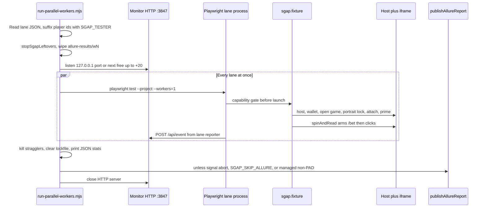

# 02 — Execution lifecycle

> Audit date: 2026-11-11. Read-only. No Playwright process was started for this audit.

## How a run is chosen

There are several drivers. The one the workspace rules treat as the normal path is the parallel runner.

| Driver | File | Selection model |
|---|---|---|
| Parallel workers | `scripts/run-parallel-workers.mjs` | A lane JSON file. Default `config/parallel-workers.json` or `SGAP_PARALLEL_CONFIG` |
| Suite queue | `scripts/run-suite-queue.mjs` | `config/qa-suites.json` families × packages. Spawns the parallel runner once per package |
| QA panel | `scripts/qa-testing-page.mjs` + `scripts/lib/execution-manager.mjs` | UI over the suite queue. Default port **3850**. PAD plans call the parallel runner with a one-game lane file |
| Staging sweep | `scripts/run-staging-tests.mjs` | `--grep-invert BF-` then `--grep BF-`, project `chromium`, workers 1 |
| Regression staging | `scripts/run-regression-staging.mjs` | Fixed directories (csf, bc, tm, mn, ap, es, at, then fs, then BF), default game `sugar-wonderland` |
| Package staging | `scripts/run-package-games-staging.mjs` | The four `game:<package-1-id>` projects |
| Probe gate | `scripts/run-game-probe-gate.mjs` | PROBE-002 then PROBE-001, retries 0, stops on first failure. Monitor default off |
| Bare `pnpm test` | `playwright test` | Exists in `package.json`. Workspace rule says agents should not use it for SGAP runs because it skips the monitor. The script itself is still present |

Extra CLI args to `run-parallel-workers.mjs` are forwarded to every lane, so a caller can pass `--grep`. The suite queue does not pass `--grep`. `--case` rewrites globs to `**/${caseId}.spec.ts` inside `scripts/lib/qa-suites.mjs`.

Lane `testMatch` becomes Playwright `testMatch` (`playwright.config.ts`). `validateLaneAssignments` throws if the same `namespace:glob` is assigned to two workers (`tests/support/parallel-lanes.ts`).

## Lane file shape

Typed in `tests/support/parallel-lanes.ts` (`ParallelLane`, `ParallelWorkersConfig`).

A lane has `id`, `category`, optional `categories[]`, `testMatch[]` or `testDir`, `playerId`, optional `gameId` / `gameName` / `games[]` / `packageId`, and a screen slot (`monitor`, `slot`, `col`, `row`). File-level fields include `workers`, `layout`, `defaultBalance`, `defaultBetLimit`, `minimumBetBalance`, optional `kind` (`pad`).

On disk (2026-11-11): about **139** hand-written `config/parallel-workers-*.json` files, plus `config/parallel-workers.json`, plus **28** generated files under `config/generated/`. Generated names look like `parallel-workers-<suite>-pkg<n>.json`, written by `writeLaneConfig` in `scripts/lib/qa-suites.mjs`. Many hand files are experiment snapshots (`*rerun*`, `*eye-gate*`, single-spec hunts). They are configs, not a rerun driver.

`games[]` is supported by `gamesForLane`. A search of `config/parallel-workers*.json` found **no** `"games"` arrays. Checked-in lanes are one game, or no `gameId` (the default file).

`config/parallel-workers.json` (sampled): two lanes, no `gameId`. W1 `CORE` globs probe/csf/sm/cp/uids/mn/fs/tm, player `Gamename1`. W2 `PLAY` globs bf/at/ap/bc/es, player `Gamename3`. Balance 15000, minimum-bet field 100. With no `gameId`, the child inherits `SGAP_GAME_ID`, which the runner defaults to `sugar-wonderland`.

## Suite families

`config/qa-suites.json` is the selector the QA page and suite queue use.

| Group | Families | Scope | Baseline `requires` |
|---|---|---|---|
| regression | CSF AT BC BF AP TM FS UIDS AS SM ES CP | `game` (every selected game) | `spin`, `bet` |
| security | PEN | `environment` (first lane of the first package only) | none |
| other | SCG | `game` | `scratchCard` |
| other | MN, WD | `game` | `spin`, `bet` |
| other | PROBE | `game`, match overridden to `probe/**/PROBE-004.spec.ts` | none |
| other | CAPTURE | `game` | `spin`, `bet`, `autoplay` |
| performance | PAD | `game`, panel `pad` | `spin` |

`@regression` expands to the regression group only. PEN is excluded. Package scope (documented in architecture README) would run on the first game of each package; **no current family sets `scope: package`**. Environment scope is PEN only.

Packages listed: `"1"` through `"9"` and `"11"`. There is no package `"10"`. Presets: `regression`, `pentest`, `full`, `scg`, `regression-remaining`.

## Runtime lifecycle (parallel runner)

Step detail, from `scripts/run-parallel-workers.mjs`:

1. Config path: `SGAP_PARALLEL_CONFIG`, else `config/parallel-workers.json`. Each lane `playerId` is suffixed with `SGAP_TESTER`.
2. Screen placement uses Windows `Screen.AllScreens` when available. A lane whose `monitor` index is past the screen count exits 1 unless `SGAP_ALLOW_SCREEN_FALLBACK=1`. One screen becomes a 2×2. Two or more screens split each screen in half. `SGAP_BROWSER_VIEW=hidden` shifts the cell off-screen.
3. `workers` in JSON is logged as `workers ?? lanes.length`. It does **not** limit `Promise.all` over lanes.
4. Each child is `node <playwright cli> test --project=… --workers=1`. Headed when launcher mode is staging unless `SGAP_PARALLEL_HEADLESS=1`.
5. Child env: `SGAP_PARALLEL_WORKERS=1`, per-lane `SGAP_RESULTS_JSON=w{id}-results.json`, `SGAP_ALLURE_DIR=allure-results/w{id}`, `SGAP_WORKER_ID`, private `PWTEST_CACHE_DIR` under `pw-cache/w{id}`. `SGAP_GAME_ID` is set from the lane only when `lane.gameId` is set.
6. Because `SGAP_PARALLEL_WORKERS=1`, `playwright.config.ts` replaces projects with one project per lane game, `workers: 1`, `fullyParallel: false`, window position/size from the lane cell. Project name is `w{id}-{category}`, plus `-{gameId}` when a lane lists more than one game.
7. Monitor: if `SGAP_WORKER_MONITOR` is not `0`/`false`, `createWorkerMonitorServer` listens on `SGAP_MONITOR_PORT` or **3847**, bound to `127.0.0.1`. `EADDRINUSE` walks the next ports up to +20. Managed QA runs set `SGAP_MONITOR_PORT=0` so the OS picks a port. Lockfile: `resultsRoot()/sgap-parallel.lock.json`.
8. About 6 seconds later, if overlays are allowed, a separate Chrome app window opens on `test-results/sgap-monitor-profile`. Routes: `/` status board, `/reader` backend reader, `/observe` Monitor Worker (only auto-opened when `SGAP_OBSERVE_WINDOW=1`). Managed runs skip the overlay unless `SGAP_MONITOR_OVERLAY=1`.
9. When every child exits: kill remaining trees (`taskkill /PID /T /F` on Windows via `scripts/lib/sgap-process-guard.mjs`), sweep leftovers, clear the lockfile, print per-lane stats. Exit 0 only if every lane exit code was 0.
10. Allure: lane dirs `wN` are wiped at start. `publishAllureReport` runs when `SGAP_SKIP_ALLURE` is not `1` and the run is not a managed non-PAD run. Suite queue publishes one combined report after copying each package’s `wN` dirs (`run-suite-queue.mjs`). History folder: `allure-history/run-YYYYMMDD-HHmmss[-runId]/`. History index default port **5055**.

### Cancellation

- `SIGINT` → exit 130, `SIGTERM` → 143, `SIGHUP` → 129. These set `shuttingDown` and return **before** the summary and Allure publish.
- `POST /api/stop` with `{workers:[ids]}` or `{all:true}` kills selected trees. A monitor stop does not set `shuttingDown`, so summary and Allure still run.
- `scripts/stop-sgap-browsers.mjs` matches `Chrome for Testing`, `[Worker `, and `SGAP Worker Monitor`. The runner’s own Windows title sweep matches `[Worker*` and `Gamename1`–`4` only. Whether the unref’d monitor Chrome always exits with the HTTP server was **not executed** in this audit. UNKNOWN.

### Recovery

There is no checkpoint that resumes a lane mid-suite. A failed process is a failed lane. Dedicated rerun scripts exist and are stale or narrow:

- `scripts/run-suite10-failures.mjs` hard-codes AP-002, BC-004, ES-006, BF-003, CSF-008 and project names `w4-CONTROL` / `w3-BUY` / `w1-CORE`, which do not match today’s `w{id}-{category}` names. It passes `--retries=0`. No Allure publish in that file.
- `scripts/isolate-gate-failures.mjs` re-runs a fixed spec list, one process each, project `chromium`.
- Named `*rerun*` lane JSON files are configs only.

## What one test does

Auto-fixtures in `tests/fixtures/sgap.fixture.ts` (Playwright orders them by dependency):

| Fixture | Behavior |
|---|---|
| `_sgapBaseline` | Family `requires` from `familyForSpec`. Skip (N/A) if unsupported. Throw `NOT CONFIGURED` if unmapped. Runs before the game opens |
| `_sgapAllure` | Metadata before, outcome after |
| `_sgapInteractions` | After the test, attach interaction journal |
| `_sgapClickTracker` | In-page click tracker, default on |
| `_sgapBetTraffic` | Attach/stop bet traffic notes |
| `_sgapRounds` | `trackRounds(page, manifest)` |
| `_sgapWorkerMonitor` | Overlay from project lane metadata |
| `_sgapObserve` | Off when `SGAP_OBSERVE=0`. Otherwise recorder, optional asset audit when `SGAP_RESOURCES=1`, attachments `monitor-summary.txt`, `balance-timeline.txt`, `monitor-worker.json` |

`sgapSession` staging path (abbreviated):

1. Raise test timeout to at least 300s before launch and 360s after attach. The Playwright config timeout of 60s is therefore not the staging budget.
2. Resolve player id (lane, lock, or generated).
3. `openGameHost`.
4. Unless this is a pasted Game URL: set host balance up to the lane default **only if** current balance is below `target - 0.5`, and set the bet limit.
5. `openGame` → `prepareGameView` → `relockPortraitToViewport` → `driver.attach` → `primeCanvasSession` → relock again.
6. If rendering is canvas, `sgapSpin.useHealer(createCanvasActionHealer(session))`.
7. `finally`: report fixture end and detach the backend reader.

Local launcher mode (`SGAP_LAUNCHER_MODE=local`) does not hit staging. It fulfills `betUrlPattern` from `tests/fixtures/samples/dijoker-bet-response.json` and uses `LOCAL_LAUNCHER_HTML`. `fixture-smoke.spec.ts` skips when the launcher is staging.

`sgapBetWatcher` is omitted when `manifest.network` is missing.

## Browser and iframe

- One OS process and `--workers=1` per lane. Playwright’s default is a new browser context per test. No shared game `userDataDir` was found. Lanes do not share the transform cache. The **monitor** Chrome does share `test-results/sgap-monitor-profile`.
- Iframe selector is data: production manifests use `iframe[title="Game session"]` (`config/manifests/sugar-wonderland.json` locator key `gameIframe`, and the same key on the other production manifests inspected via the loader pattern).
- Portrait: `fitPortraitSize` returns width less than height. `prepareGameView` sets the mobile viewport from `portraitAspectFor(manifest)` and may reload the frame (two attempts). `relockPortraitToViewport` sizes the iframe element, not the outer Playwright viewport. Parallel projects size the viewport from the window cell minus chrome (16×88) via `innerViewportForWindow`.
- `orientationLock === 'landscape'` selects the desktop view. Rotate-to-portrait copy is detected with `/rotate to portrait/i`.
- Game clicks go to the frame. Host clicks (balance, bet limit, game tile) stay on the launcher page.

## Readiness

`src/readiness/index.ts` exports only `READINESS_LAYER`. Nothing else calls it.

Actual readiness:

- Healer `prepare('spin')` calls canvas prepare, `waitForBetQuiet`, then `waitForIdleHud` (12s budget in the canvas healer).
- `waitForIdleHud` (`tests/support/canvas-healing.ts`) waits for an open round first.
- `RoundTracker.waitForResolved` (`src/network/round-tracker.ts`): stall **45s** without progress, hard cap **180s**. Outcomes: `none`, `resolved`, `stalled`, `timeout`.
- A feature round is identified by `unresolvedSpin` (manifest field or default name) on an ok initialize or bet/buy, progress via `PATCH /api/v1/unresolved-spin/<id>`, close via `…/complete` or a later body with no id. The file header states plain spins do not open a round. Non-ok responses are ignored.
- Initialize capture helper uses 45s (`tests/support/session-health.ts`). `countBetsUntilIdle` uses 45s for the first bet, 180s overall, max 40 bets (`tests/support/canvas-bet-flow.ts`).

## Retries and failure handling

| Layer | Policy |
|---|---|
| Playwright | 1 retry on staging or CI, else 0. Overridden by `--retries=0` on the probe gate and `run-suite10-failures.mjs` |
| `SpinController.spinAndRead` | `maxAttempts` default **2**. A classified `defect` is not retried. A `/bet` that arrives in a fresh 2s arm is accepted without a second click. Otherwise `healer.recover` and the next click may use a healed ratio |
| `spin()` | Does not loop |
| Amplify / autoplay helpers | Their own attempt loops (defaults 3, 2, or 5 depending on the helper). These are not the healer |
| Server error body | Not healed. Watcher only accepts `response.ok()` |

Session id for the monitor includes `testInfo.retry`, so a Playwright retry is a distinct observation session. Allure grouping is the Allure SDK history id, influenced by a non-excluded `gameId` parameter (`tests/support/sgap-allure.ts`). SGAP does not assign its own `historyId`.

## Timeouts (collected)

| Site | Value |
|---|---|
| `playwright.config.ts` | test 60s, expect 10s, action 15s, navigation 30s |
| Fixture staging floors | setup at least 300s, test at least 360s |
| `SpinController` default action wait | 30s |
| Canvas healer spin `/bet` | 45s staging, 30s local |
| Round tracker | 45s stall, 180s cap |
| HUD idle after the round | default 8s (`waitForIdleHud`) |
| FS-008 spec | `max(600s, MAX_BUYS * 180s)` |

## Wallet behavior during execution

This is execution policy, not a security review.

- Staging fixture tops the host wallet toward the lane `defaultBalance` when the current balance is short by more than 0.5, and sets the bet limit. Generated configs use 15000 / 15000. A restore helper constant `STAGING_DEFAULT_WALLET = 20000` lives in `tests/support/launcher-balance.ts`.
- `minimumBetBalance` (often 100) is logged by the runner and typed on the config. **No test reads that field.** ES-005 hardcodes amount `100`. BF-004 computes `max(stake, buyCost/2)`.
- No symbol `SGAP_MAX` exists in the repo.
- FS-008: `SGAP_FS008_MAX_BUYS` (invalid or 0 defaults to 3), `SGAP_FS008_MAX_SPEND` (0 means no cap), refill only if `SGAP_FS008_REFILL_WALLET=1`. `decideNextBuyBudget` (`src/verification/buy-feature-spend.ts`) stops when `spent + nextCost > maxSpend`.
- `countBetsUntilIdle` `maxBets` 40 stops the counter. It is not a wallet floor.
- Buy Feature cases run after non-BF in the staging sweep so that feature purchases do not disturb earlier balance checks. That ordering is a script convention (`run-staging-tests.mjs`), not a lock in the fixture.

## Game initialization

`PlaywrightPlatform.getInitializeBalance` / `getInitializeBody` expose the initialize response captured during open. `RoundTracker` also watches initialize for `unresolvedSpin`. PROBE and PEN helpers read initialize fields (`maxWin`, balance, unresolved id). There is no separate `IGameEventObserver` emission for `initialize` even though `GAME_EVENT_IDS` includes that name.

Discovery specs (`DISC-001`) are the exception to the baseline gate: they learn a pasted game and assess which cases can run. `unregistered.json` is the discovery template (`metadata.discovery: "runtime"`), not a production title.

## Optimization mechanisms that exist

- Eye-gated overlays: do not tap when the HUD is idle (`SGAP_BLIND_OVERLAY_TAPS` is the A/B escape hatch).
- Late-bet short wait avoids a duplicate spin click.
- Parallel lanes are processes, not Playwright workers inside one browser, so a hung page does not share a browser with another game.
- Asset loads that succeed are counted in the observer, not stored in full.
- Websocket keep-alives are counted, not stored. Persisted websocket payloads are short previews (architecture README: 300 characters).
- Static successful asset bodies are not kept on the network observation.

## What this lifecycle does not do

- It does not resume an unresolved spin as a first-class test lifecycle step, except where a spec (PEN-072, PAD-055) reloads on purpose. PAD-055 asserts FPS on the resumed play, not identity of `unresolvedSpin`.
- It does not select tests from Google Sheets.
- It does not cap how many lanes start, except by how many lanes the JSON lists and by whatever the QA page planner does before writing that JSON.
- It does not publish Allure on the probe gate path inside `run-game-probe-gate.mjs`.
