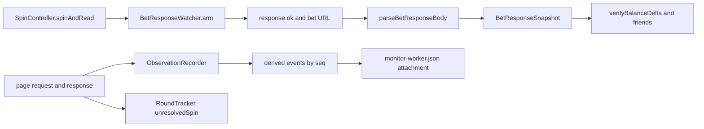

# 03 — Network and gameplay data

> Audit date: 2026-11-11. Read-only. No live traffic was captured. Payload examples in source comments are described by field name only.

## Capture architecture

The waiter and the recorder are separate. The waiter returns one snapshot to the spec. The recorder keeps a timeline for the report. They do not share a spin id.

## `/bet` waiter

`BetResponseWatcher` (`src/network/bet-response-watcher.ts`, class at line 30) implements `IBetResponseDataSource` (`kind: 'betResponse'`).

Armed by `SpinController.spinAndRead` (`src/controllers/spin-controller.ts`): healer prepare, `watcher.reset()`, `watcher.arm({ timeoutMs })`, one spin click, `watcher.read`. On timeout it may `readLateBet`, which resets and arms a **new** 2 second waiter. A response that already arrived is not replayed from a buffer.

The fixture constructs `sgapBetWatcher` from `manifest.network` (`tests/fixtures/sgap.fixture.ts`). If `network` is missing, there is no watcher.

Arm predicate: `response.ok()` and (`matchesUrlPattern(url, network.betUrlPattern)` or the URL includes `/api/v1/slots/bet`). `matchesUrlPattern` (`src/network/bet-url.ts`) strips query and hash. Manifest pattern wins when it matches. `PLATFORM_ROUTES` defaults:

- bet: `/api/v1/slots/bet`
- buy: `/api/v1/slots/buy`
- initialize: `/api/v1/slots/initialize`
- unresolved: `/api/v1/unresolved-spin/`

Non-ok responses never satisfy the waiter. The recorder can still emit `bet-failed`.

`read` steps:

1. `response.json()`.
2. `parseBetResponseBody(body, network.fields)` (`src/data/parse-bet-response.ts`).
3. Request `postData()` JSON: stake and `isEnhancedBet`. Stake is copied onto `snapshot.bet` when the response parse did not set `bet`. The response parser does not set `bet`, so stake comes from the request.
4. Raw request object stored as `betRequest`.

`getLast()` is the last snapshot. `reset()` drops the pending waiter only.

Autoplay does **not** use this watcher. `armBetResponses` in `tests/support/autoplay-flow.ts` uses `page.waitForResponse` for N ok bet responses.

Buy flow `buyFeatureForBet` (`tests/support/canvas-bet-flow.ts`) keeps the first response that `isBuyPurchaseResponse` accepts and flags a stray normal `/bet`.

### What counts as a buy

`isBuyPurchaseRequest` / `isBuyPurchaseResponse` (`bet-response-watcher.ts`): URL contains `/api/v1/slots/buy`, or a `/bet` body with `action === 'buy'` or `buyFeat > 0`. The response helper also requires HTTP ok. `buyFeat` of 0 or 1 is a flag, not a price (`resolveGrossBuyCost` comment and implementation in `src/verification/buy-feature-spend.ts`).

## Fields actually copied into `BetResponseSnapshot`

Type: `src/core/models/index.ts` (`BetResponseSnapshot`: `raw`, optional `bet`, `win`, `balance`, `transactionState`, `isEnhancedBet`, `betRequest`).

`parseBetResponseBody` copies only:

| Manifest path key | Snapshot field |
|---|---|
| `fields.balance` | `balance.amount` / `balance.raw` |
| `fields.totalWin` | `win.amount` / `win.raw` |
| `fields.transactionState` | `transactionState` when it is a string |

Sugar Wonderland’s manifest also declares `slot.base.win` and `slot.bonus.win` style paths (`baseWin`, `bonusWin`). Those paths are on the manifest and can be learned by payload discovery. **`parseBetResponseBody` does not read them.** `FreeSpinsSnapshot` exists on the model and is not produced by this parser.

Request keys the stake/enhance parsers look at (`src/data/parse-balance.ts`): `bet`, `amount`, `stake`, `totalBet`, `betAmount`, `wager`, `isEnhancedBet`. Buy helpers also read `buyFeat` and `action`. A model comment says Package 1 posts `action`, `bet`, `line`, `buyFeat`, `isEnhancedBet`, `isFs`. The parser does not read `line` or `isFs`.

`getByPath` (`src/shared/json-path.ts`) is dot segments only. `getAllByPath` fans out on `[]`.

## Other body shapes that some checkers read

These are **not** the snapshot. Callers pass the raw body.

| Concern | Where | Paths |
|---|---|---|
| Boards | `readBackendSpin` in `src/verification/reel/backend-reader.ts` | `slot.area` and `data.` / `result.` prefixes, `slot.reels`, tumbles/cascades/avalanches |
| Free-spin items | `discoverFeatureSpinItems` in `src/shared/spin-payload-discovery.ts` | `slot.freeSpin.items`, `slot.freeSpins.items`, `slot.feature.items`, `slot.bonus.items`, `slot.bonusSpins.items`, plus `data.` / `result.` / bare `freeSpin.items`, then a walk |
| Remaining spins | same module | `spinsLeft`, `spinsRemaining`, `remaining`, `roundsLeft`, `freeSpinsLeft`, `left` |
| Ways wins | `readReelMultiplierWins` in `src/verification/reel-multiplier.ts` | `symbols.out.multipliers`, `symbols.out.symbols[]` with `symbol`, `columns`, `ways`, `pay`, `win`, `multiplier` |
| Cluster cells | `readTumbleClusterWins` in `src/verification/position-multiplier.ts` | `symbols.out[].positions`, `win.multiplier` |
| Payline multipliers | CSF-011 generic branch via `getAllByPath` | manifest `normalModeMultiplierPath`, e.g. `slot.paylines[].multipliers` |
| Hold and win | `inspectHoldNode` in `tests/support/scenario-watch.ts` | `slot.holdAndWin`, `slot.respin(s)`, `slot.bonus.*`, `slot.moneyRespin`, `data.slot.*`, plus `metadata.holdAndWinPath` |
| Round id | `RoundTracker`, `payload-learn.ts` | `network.fields.unresolvedSpin` or `unresolvedSpin`, also `data.unresolvedSpin`, `slot.unresolvedSpin` |
| Refund keyword | observation recorder | any key matching `/refund/i` within depth 6 emits `refund-received` |
| Scatter count | `countScatterInArea` | ids in `area`, default id `{0}`, thresholds from package rules |

A bundle is treated as complete when more than one free-spin item has an area. Remaining is then forced to 0. `payloadsToWalk` in `evaluateFreeSpinRetrigger` keeps a single body in that case so a cloned bundle is not double-counted. An offline smoke file asserts that (`src/verification/smoke-free-spin-retrigger.ts`). That is a unit-level check, not a staging run.

## Normalized structures that exist

| Type | File | Produced by |
|---|---|---|
| `BetResponseSnapshot` | `src/core/models/index.ts` | `BetResponseWatcher.read` |
| `BalanceSnapshot`, `WinSnapshot`, `BetSnapshot` | same | parsers. `currency` is optional and unused by the delta |
| `FeatureSpinItem` | `src/shared/spin-payload-discovery.ts` | discovery walk |
| `BackendSpinRead` | `src/verification/reel/backend-reader.ts` | reel reader |
| `FreeSpinRetriggerVerdict` | `src/verification/free-spin-retrigger.ts` | `evaluateFreeSpinRetrigger` |
| `ReelMultiplierWin`, cluster win types | multiplier modules | CSF-011 path |
| `OpenRound` | `src/network/round-tracker.ts` | `RoundTracker` |
| `VerificationResult` | models | `kind`, `passed`, `message`, `expected`, `actual` |
| `Observation` | `src/observability/types.ts` | `network`, `console`, `websocket`, `event`, `balance`, `resource`, each with `seq` |
| `ExecutionRecord` | models | keyed by `manualTestId` |

Declared and **not produced** by a class: `GameEventPayload`, `HistoryEntry`, `IHistoryDataSource`, `ISessionDataSource`, `IWalletDataSource`, `FreeSpinsSnapshot` from the bet parser. `DATA_SOURCE_KINDS` includes `history`. Nothing registers it.

`GAME_EVENT_IDS` (`initialize`, `offline`, `reconnect`, `sessionTimeout`, `betFailed`, `bonusStart`, `bonusEnd`, `maxWin`) live in `src/core/constants/index.ts`. `src/events` does not emit them. The observation recorder uses **different** names: `spin-started`, `bet-attempted`, `spin-completed`, `bet-failed`, `refund-received`, balance changes, modals, insufficient-balance, buy-feature, scratch, game-initialized, recovery-attempt. Those are derived strings, not the constant enum.

## Can one spin be correlated?

**No shared spin id crosses network, HUD, verification, and the report.**

What does exist, and what it covers:

| Link | Scope | Gap |
|---|---|---|
| The Playwright `Response` the waiter awaited, plus `response.request()` | One spec call to `spinAndRead` or `armBetResponses` | A second ok `/bet` in the same test is a different response. The waiter does not dedupe two ok bodies |
| `unresolvedSpin` string | Feature rounds only. `RoundTracker` and PEN initialize helpers | Not copied onto `BetResponseSnapshot`. `describeRound` prints the first 8 characters. Plain spins never open a round |
| Observation `seq` / `relatedSeq` | One test timeline. `deriveFromResponse` points `spin-completed`, `buy-feature`, `bet-failed`, `refund-received`, `server-balance-changed` at the network entry | Not a round id. Not stable across retries or games. Session id includes `testInfo.retry` |
| `PerfSession.mark('bet' / 'round-progress' / 'round-complete')` | URL method, path, status | No spin id |
| Allure history id | Test case × `gameId` parameter | Not a spin |
| `InMemoryExecutionTracker` | `manualTestId` | Not a spin |

So a consultant should assume: **a single spin can be tied to the response object the spec just awaited, inside that test.** It cannot be reconstructed later from Allure history as a normalized gameplay event with one id. HUD samples are a 500 ms poll (`SGAP_OBSERVE_BALANCE_MS`, default 500) plus a sample on each bet response. They can disagree with the server for a frame. That disagreement is how AT-003 Sugar was argued (see historical notes in `08`). It is not a join key.

## Balance

`verifyBalanceDelta` (`src/verification/bet-response-verification.ts`, function at line 83):

- Inputs: `before`, `after`, `win`, optional `stakeAmount` default `'0'`, `tolerance` default `0.01`.
- Expected: `before - stake + win`.
- Output: `VerificationResult` kind `'balance'`.

`verifyBetSpinOutcome` runs the delta only when stake is explicit. `verifyImpliedPreSpinBalance` is the fallback: `after + stake - win > 0`.

Specs that call the delta and expect `passed` include CSF-005, CSF-007, CSF-008, BF-006, BF-010, AT-009 (files under `tests/specs/`). Offline smoke: `src/verification/smoke-bet-verification.ts` (delta must not run without an explicit stake). **This audit did not re-run those specs.** Status of the formula is IMPLEMENTED, with historical Allure runs that included these ids at various dates. It is not VERIFIED for every package on 2026-11-11. See `06`.

`roundCents` is `Math.round(value * 100) / 100` (`src/verification/at003-evidence.ts`). Ways wins use the same cent round with `0.011` slack. Amounts travel as JavaScript numbers after `toAmountString` does `String(number)`, so binary float is already baked in before the cent round. `BalanceSnapshot.currency` is not filled by `parseBetResponseBody`.

The monitor timeline uses the same cent round and emits `server-balance-changed`. It does not assert the wallet equation.

## Failed transactions and refunds

- Watcher ignores non-ok HTTP.
- Recorder emits `bet-failed` / `buy-feature-failed` with status and `message`.
- If any JSON key matches `/refund/i` (depth 6), recorder emits `refund-received`. It does not check that the wallet moved back.
- AT-003 classifies an injected HTTP 500. The classifier comment states the injection is Playwright-fulfilled and **does not prove a staging refund** (`src/verification/at003-evidence.ts`). Treat AT-003 as a HUD-sync and classification case, not as proof of operator refund policy.
- `transactionState` is stored when the manifest path yields a string. No central enum of legal states was found in `src/data`.

## Duplicates and bundles

- Late duplicate click: `spinAndRead` will not click again if a late `/bet` appears inside the 2s re-arm. It does not dedupe two successful bodies.
- Bundled free spins: one body is walked when the bundle is complete. Offline smoke covers the clone case.
- Asset SHA-256 duplicate groups (`src/perf/asset-audit.ts`) are download duplicates, not bet duplicates.

## Replay and history

No slots history or replay URL client exists under `src/`. Platform routes in code are bet, buy, initialize, and unresolved-spin.

“Replay” in this repo means one of:

- A JPEG `replay.html` written by the capture hunt (`tests/support/capture-reel.ts`). It does not re-check an outcome.
- Scratch hub invocation-id replay in `PEN-010` (cashout frame must not credit twice). That is the scratch hub, not `/bet`.
- Replaying tumble order inside one response (`position-multiplier.ts`).
- PAD-055 “replayed spins”: the client plays a resumed round. The assertion reviewed is FPS.

## Scratch hub versus slots

`ScratchHubWatcher` / `ScratchHubClient` (`src/network/`) are a second protocol (SignalR-style hub targets: StartRound, Cashout, and similar). PEN-001 through PEN-064 and SCG specs use that surface. Slot pentest files are `PEN-070` through `PEN-073`. A PEN result is not evidence about `/bet` math unless the spec is in the slot files. `docs/catalogs/PENTESTING.md` states `@regression` never includes PEN.

## Learning paths

`src/discovery/payload-learn.ts` proposes candidate paths for balance, win, area, and tumbles. Output is paths (`PayloadFields`), not stored payloads. Learned manifests are merged by `withLearnedProfile` in the fixture. `scripts/lib/learned-secrets.mjs` strips URL- and token-shaped keys. This audit did not open learned stores.
